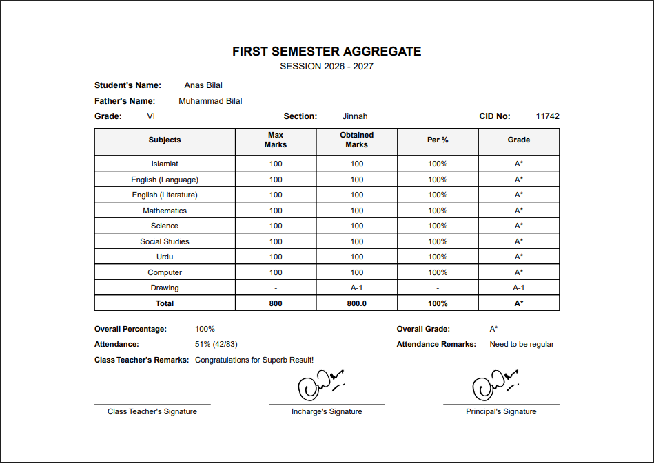
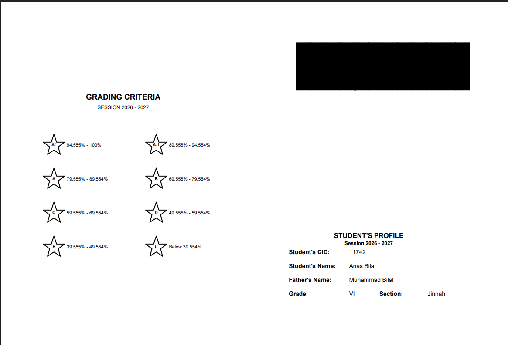
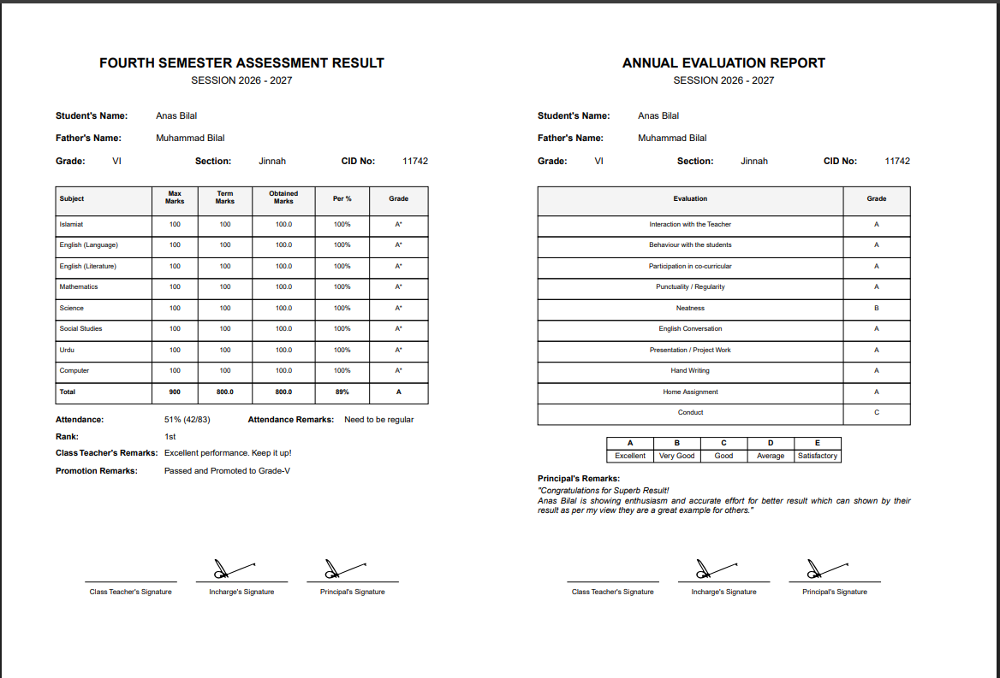

# 🎓 Report Generator

Welcome to the **School Automated Report Card System**. This tool simplifies the process of generating both Standard and Annual student report cards. By simply uploading an Excel data file, the application parses the student grades, evaluates performance, and outputs pixel-perfect PDF reports—all neatly packaged into a `.zip` file for instant download.

---

## ✨ Features

- **Automated Grading Engine:** Automatically calculates percentages, assigns letter grades, evaluates pass/fail status, and generates personalized teacher remarks based on performance.
- **Dual PDF Formats:** 
  - *Standard Report:* A clean A4 Landscape layout.
  - *Annual Report:* Designed as a foldable A3 Landscape booklet (covers, inner-left, inner-right, back cover).
- **Modern Web Interface:** A sleek, intuitive, premium UI built with Tailwind CSS.
- **One-Click Deployment:** A pre-configured batch script (`Start_App.bat`) completely automates dependency installation and starts the server for non-technical users.
- **Dynamic Content Mapping:** Intelligently maps subjects, evaluations, and student meta-data directly from raw Excel headers without needing complex formulas.

---

## 📸 Screenshots

### Standard Report


### Annual Report



---

## 🚀 Quick Start (For Windows Users)

The absolute easiest way to run the application is to use the included batch file.

1. Clone or download this repository to your machine.
2. Ensure you have **Python** installed. *(Make sure "Add Python to PATH" was checked during installation).*
3. Double-click the **`Start_App.bat`** file.

That's it! The script will automatically install missing dependencies (like `flask`, `pandas`, `openpyxl`, `reportlab`) and instantly open the web portal in your default browser at `http://127.0.1.1:5000/`.

---

## 💻 Manual Developer Setup

If you prefer to run the application manually from the terminal:

1. **Install Requirements:**
   ```bash
   pip install -r requirements.txt
   ```
2. **Start the Flask Server:**
   ```bash
   python app.py
   ```
3. **Open the App:** Navigate to `http://127.0.1.1:5000/` in your web browser.

---

## 📝 How to Use

1. Click on **Download Template File** in the web interface to get the exact Excel layout required.
2. Fill out the student names, marks, and evaluation metrics in the Excel sheet.
3. Select your **Session, Grade, Semester, and Campus** from the dropdowns on the web interface.
4. Upload your filled-out Excel file.
5. Click **Generate & Download Reports**. 
6. A `.zip` file containing every student's individual PDF report will instantly start downloading!

---

## 🛠️ Technology Stack

- **Backend:** Python, Flask
- **Data Processing:** pandas, openpyxl
- **PDF Generation:** ReportLab, svglib
- **Frontend:** HTML, Tailwind CSS, JavaScript (Fetch API)
